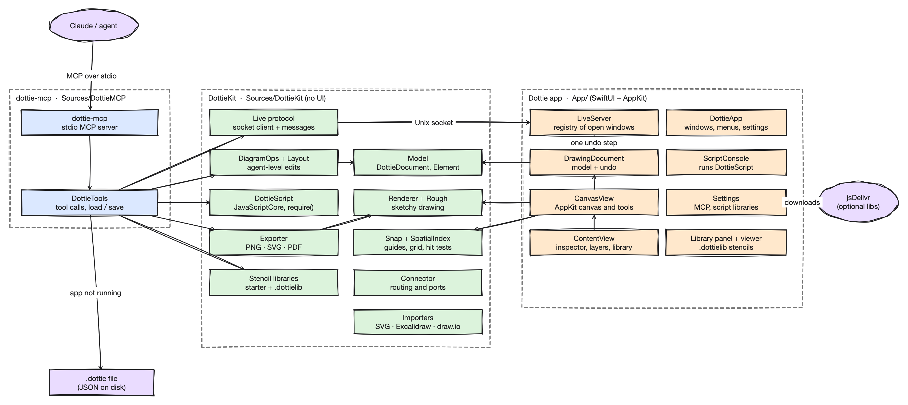

# Developing Dottie

Native SwiftUI + AppKit app on top of `DottieKit`, a SwiftPM library with everything that can be tested without
a UI (model, renderer, exporters, importers, scripting). `dottie-mcp` (the MCP server) and `dottie` (the command
line tool) are built on the same library and ship inside the app at `Contents/Helpers`. See `ROADMAP.md` for
what is done and planned.



## Build and test

You need Xcode 26, [XcodeGen](https://github.com/yonaskolb/XcodeGen) and [just](https://github.com/casey/just).

```sh
just test          # DottieKit and MCP logic, headless (swift test)
just canvas-test   # drives the real canvas view with synthesized mouse events
just run           # generate the Xcode project, build and launch the app
just mcp           # release build of dottie-mcp; just mcp-install registers it with Claude Code
just cli           # release build of dottie; just cli-install links it into ~/.local/bin
```

`Dottie.xcodeproj` is generated from `project.yml` and gitignored, so change settings there, not in Xcode.

**Website.** `website/` is the GitHub Pages site (Material for MkDocs) at https://dottie.phin.tech, published by
`.github/workflows/pages.yml` on pushes to `main` that touch it. The domain is the repo's Pages custom domain, with
a DNS-only CNAME from `dottie.phin.tech` to `phin-tech.github.io` in Cloudflare (proxying it would get in the way
of GitHub's certificate); the old `phin-tech.github.io/dottie/` address redirects there. Its demos are the drawings in
`website/docs/drawings`, made by `just demos` (and `just readme-animation`) on a Mac and committed, and played
live by `<dottie-player>` from the published npm package (`@phin-tech/dottie@0.5.1` via jsDelivr, set in
`website/mkdocs.yml`), so a change to `web/` reaches the site once it is published. Preview it with
`pip install -r website/requirements.txt && just site`.

**Publishing dottie.js.** dottie.js goes out at Dottie's own version: `just bump` sets `web/package.json` and
`VERSION` in `web/src/index.ts` along with the app's, and a test fails if they ever differ. Publish it with each
release: `cd web && npm publish` (it runs the tests and builds first; the `@phin-tech` npm organization owns it).
Once it is on npm, point `website/mkdocs.yml` at the exact new version (a range is cached for days).

**Looking at the running app.** `just debug-app file.dottie` launches a Debug build in the background on its own
live socket (`DOTTIE_LIVE_SOCKET`), so it doesn't take over the socket your everyday Dottie uses, and
`just debug <command>` drives it through `scripts/dottie-debug.py`: `snapshot out.png [canvas]` has the window
render itself to a PNG (no screen-recording permission needed; translucent toolbars and the inspector come out
blank), and `playhead`, `play`, `action`, `select`, `drag`, `key` and `menu` move it around. `just debug help`
lists everything. The commands exist only in Debug builds (`App/DebugDriver.swift`).

**Targets.** `Dottie` (the app) embeds `DottieCLI` and `DottieMCP` in `Contents/Helpers` and two Quick Look
app extensions in `Contents/PlugIns`, all linking DottieKit:

- `DottieQuickLookPreview` (`QuickLook/Preview`): a data-based `QLPreviewProvider` that answers Space in Finder
  with `Exporter.pdf(_: DottieFile)`, one PDF page per Dottie page. A `.dottielib` previews as
  `StencilLibrary.sheet()`, its items in a grid.
- `DottieQuickLookThumbnail` (`QuickLook/Thumbnail`): a `QLThumbnailProvider` that draws the first page (or the
  library sheet) with `Exporter.draw(_:in:size:)`, sized by `Exporter.fittedSize` so Finder doesn't letterbox it.

Both are sandboxed (Quick Look requires it; the previewed file is readable without further entitlements) and
use `Signing.xcconfig` like the other targets. Their version comes from the project-level `MARKETING_VERSION`
and `CURRENT_PROJECT_VERSION`, which must match the app's. To try them, build, then register the built app with
`lsregister -f -R -trusted <Dottie.app>` (or launch it once) and check `pluginkit -m -A -i tech.phin.dottie.QuickLookThumbnail`.
A plus sign in that listing means the extension is enabled.

**Signing.** Builds are signed to run locally unless a gitignored `Signing.local.xcconfig` sets
`DEVELOPMENT_TEAM` and `CODE_SIGN_IDENTITY = Apple Development` (see `Signing.xcconfig`). Set the team there
rather than in Xcode's Signing & Capabilities pane, which is lost when the project is regenerated.

## dottie.js

`web/` is a TypeScript library that reads `.dottie` files and draws and plays them in the browser
(`<dottie-player src="…">`); its [README](web/README.md) covers using it. It ports what draws a page rather than
wrapping a picture of it: `resolved(at:)` and everything under it (keys, eases, visibility, reveal, follows,
repeats, boil, settle, camera, scenes), connector routing, and `SVG.swift` with `Rough.swift`, hatching and
dungeon grids (ported rather than taken from rough.js, so the same seeds give the same strokes). Labels and
sticky notes are measured with Helvetica Neue widths, kerning and line metrics taken from CoreText by
`scripts/font-metrics.swift` (output: `web/src/metrics.ts`), so they wrap where Dottie wraps them.

The risk is drift: Dottie gains a feature or changes routing and dottie.js quietly draws something else. Four
things guard against it:

1. **Fixtures.** `fixtures/` holds the drawings both sides read: copies of `Design/` and the demos
   (`fixtures/design`), and small edge cases written by `scripts/make-fixtures.py` (`fixtures/edge`: every kind,
   routing, arrowhead, fill, transition, follow, repeat, camera, theme, note layout, and damaged timelines).
   Files only dottie.js has to survive (unknown kinds, newer versions) are in `fixtures/js-only`. A bug fixed on
   either side adds a fixture.
2. **Goldens.** `dottie inspect file.dottie [--page P] [--at T]...` prints what a page resolves to with no drawing:
   each element's frame, rotation, opacity, reveal, seed and stacking order, each connector's endpoints and
   route, the camera's view and the scene. `just goldens` regenerates the fixtures and writes, for each one,
   that structure at a spread of times (`fixtures/goldens/<group>/<name>.json`) and Dottie's own SVG of every
   page at a few moments, clean and sketchy (`fixtures/goldens/svg`). dottie.js's tests compare its own
   `inspect` with the first within 0.002, and its SVG with the second line by line; today they are identical.
   `npm run visual` also rasterizes both SVGs in Chromium and compares pixels (a looser net for when exact
   output stops being the goal), writing a side-by-side report to `web/test-results/visual/report.html`.
3. **Schema.** `schema/dottie.schema.json` describes the format. `SchemaTests` checks that every fixture and a
   drawing with every optional field set validate, and that every stored property of the model types is in the
   schema; dottie.js has a test that it reads exactly the schema's fields. Changing the model without the schema
   fails the first, and changing the schema fails the second until dottie.js is updated. dottie.js itself reads
   leniently: anything it doesn't know is drawn as a labelled placeholder or ignored, and listed in `warnings`.
4. **CI** (`.github/workflows/web.yml`). A macOS job regenerates the fixtures and goldens and fails if they
   differ from what's committed ("run just goldens"), and runs `SchemaTests`; a Linux job runs dottie.js's unit,
   contract, SVG, visual and browser tests against the committed goldens. A PR that changes `resolved(at:)`,
   routing or the SVG export therefore has to update the goldens, which makes the dottie.js tests fail until the
   port catches up, in the same PR.

**Compiled drawings.** `dottie render -f js` and dottie.js's `dottie-compile` write the same thing: the player
runtime (`web/dist/dottie-player.min.js`) followed by the loader in `web/src/compile.ts` with the page as JSON.
DottieKit embeds both in the generated `Sources/DottieKit/PlayerScript.swift`; after changing `web/`, run
`just player-script` and commit it (the Linux CI job fails if it is stale).

[`web/PARITY.md`](web/PARITY.md) lists each feature as supported, partial or missing with its fixture; a new app
feature lands there as a missing row.

```sh
just goldens        # fixtures and goldens, after a change to DottieKit's drawing or animation (Mac only)
just web-test       # dottie.js's unit, contract and SVG tests (cd web for npm run visual / test:browser)
```

## Releasing

**One command:** `just ship patch` (or `minor`, `major`, `beta`). It bumps the version (`just bump`), commits and
pushes to `main`, stages dottie.js on npm (`SKIP_NPM=1` skips that; the version goes live when you approve it with
2FA), builds the app headless, signs it with the Developer ID Application certificate, notarizes it with Apple and
staples the ticket (`just notarize`), then publishes the GitHub release, its Sparkle appcast and the Homebrew cask
(`just release`). Write `release-notes/<next version>.md` first for curated notes. It must run on a Mac with the
certificate in its keychain, from a clean, pushed `main`. Every release recipe takes `--dry-run`, which runs the checks
and reads but only prints what it would change: `just ship beta --dry-run`.

**Betas.** `just ship beta` makes the next beta: from 0.6.1, `0.7.0-beta.1`, then `-beta.2`. For a beta of a
patch or a major instead, `just ship beta --of patch` (0.6.1 → `0.6.2-beta.1`) or `--of major` (`1.0.0-beta.1`);
later betas carry on with plain `just ship beta`, and `just ship patch` releases it. A beta is a GitHub
pre-release, so GitHub's "latest", the download link and the cask stay on the last release. dottie.js goes to npm
under the `beta` tag. Its appcast entry is added to the latest release's appcast in Sparkle's `beta` channel, which only
copies with Settings › Updates › Get beta versions turned on take (on by default in a beta build). A later
`just ship minor` (or `patch`) releases the beta's version, `0.7.0`, and beta testers move on to it, since the build
number only goes up.

**The tooling** is [app-release](https://git.phin.tech/sam/app-release), shared with the apps made from
[apple-template](https://git.phin.tech/sam/apple-template): a Python program pinned to a tag in
`scripts/release/pyproject.toml` and run with uv, which fetches it with your git credentials for git.phin.tech. What it
knows about Dottie is in `release.toml`; dottie.js's steps (the npm version, the embedded player, staging on npm) are
hooks in `scripts/release/hooks.py`. Its lanes are written over a little DSL of plumbum commands: `read()` for commands
that only look, `run()` for ones that change something (skipped in a dry run), `secret()` for values never to print.
`just release-check` checks `release.toml` and the hooks, and `just doctor` everything a release needs outside the
repository. A fix to the tooling goes in app-release, then a new tag here. Versions are written by [bump-my-version](https://github.com/callowayproject/bump-my-version) (`.bumpversion.toml` lists the
files), and the appcast by Sparkle's own `generate_appcast`. Settings come from the environment (`NOTARY_OP_ITEM`,
`DEVELOPMENT_TEAM`, `NOTARY_PROFILE`, `SKIP_NPM`), so a build machine can run it unattended; `op` works there with a
1Password service account (`OP_SERVICE_ACCOUNT_TOKEN`).

Credentials come from 1Password (the Mac App Release item, `op://Development/lc6wrq7lltjd47uue26cdxttzu`: the Apple
ID, team ID and an app-specific password, the Developer ID certificate as `p12` with its `p12_passphrase`, the Sparkle
key and the npm token; its notes cover setting up a new Mac), so a Mac needs only the 1Password CLI signed in
(`op signin`) to release. The certificate goes into a keychain made for each run and deleted afterwards, so it doesn't
have to be in the login keychain. Without `op`, `just notarize` falls back to a notarytool keychain profile: `xcrun notarytool store-credentials dottie-notary --apple-id <apple id> --team-id
J35P7AJDN7`.

The steps by hand, if one fails halfway:

1. `just bump patch`, commit and push, then `cd web && npm stage publish`.
2. `just notarize` (or in Xcode: Product ▸ Archive, then Distribute App ▸ Direct Distribution). It leaves the
   app in `build/release/<version>/export/Dottie.app`.
3. `just release build/release/<version>/export/Dottie.app` (with no argument it takes the newest app Xcode
   notarized): checks it is a stapled, notarized Developer ID build of the version in `project.yml` and that
   `main` is clean and pushed, then publishes `Dottie-<version>.zip` as a GitHub release tagged `v<version>`. Its
   notes are `release-notes/<version>.md` when that exists, and generated from the commits otherwise. Then it makes
   the appcast (`just appcast` redoes that) and, for a release, points the cask in
   [phin-tech/homebrew-tap](https://github.com/phin-tech/homebrew-tap) at the new zip (`just tap` redoes that).

**Updates.** The app updates itself in place with [Sparkle](https://sparkle-project.org) (`UpdateChecker`). Its feed,
`SUFeedURL`, is `releases/latest/download/appcast.xml`: an asset of the newest release (GitHub skips drafts and
pre-releases), made by Sparkle's `generate_appcast` in `just appcast`. Entries are signed with the EdDSA key in the Mac
App Release 1Password item (`sparkle_private_key`, given to the tool on stdin; the public half is `SUPublicEDKey` in
`project.yml`), so installed copies only accept updates from this key. Do not lose or replace that key: copies already
out there would reject every later update. `generate_appcast` leaves an entry unsigned, without failing, when the key
doesn't match the app's `SUPublicEDKey`; `just appcast` checks every entry is signed and the new one verifies before it
uploads. Sparkle's tools are downloaded, pinned, into `~/Library/Caches/app-release`. The cask sets `auto_updates true`, so
`brew upgrade` skips Dottie unless `--greedy`. Debug builds do not check for updates.

Copies older than the first Sparkle release (0.5.3) have to be updated by hand once.

## File format

A `.dottie` file is JSON (sorted keys, pretty-printed, rounded frames, so it diffs well in git): a `DottieFile`
with `version` and `pages`. Each page (`DottieDocument`) has an id, a name, layers, elements, guides and a theme.
Element ids are unique across the file, which is what lets a link point at a shape on another page.
A `note` element is a sticky note whose `text` is GitHub Flavored Markdown; `Note` parses it with
[swift-markdown](https://github.com/swiftlang/swift-markdown) (cmark-gfm), DottieKit's only dependency, and lays
it out with CoreText, and the renderer and SVG export share that layout. A single newline is a line break, as in
GitHub comments, and bare URLs are underlined by `Note` itself (swift-markdown leaves cmark's autolink extension off). Dottie 0.1.1 and earlier cannot open a file containing a note.
An `image` element's picture is saved once per file, in a top-level `images` table keyed by its SHA-256 (`data`,
base64, and `format`, `png` or `jpeg`); the element holds `"image": {"ref": "<sha256>"}`, so copies cost nothing.
In memory and everywhere outside a `.dottie` file (clipboard, live mode, libraries) the element carries the
picture inline, and copies share one buffer. A reference with no table entry opens as a crossed-out box. Every picture
is normalized on the way in by `ImageImport` (EXIF rotation applied, longest side capped at 2048 px, re-encoded
as PNG, or JPEG for large opaque photos) so SVG and HTML exports can embed the bytes as a `data:` URI. Decoded
images are cached by that digest, always recomputed from the bytes. Versions before pictures cannot open a file containing one.
A page's `symbols` are drawings placed by `symbol` elements (instances), each with its own layers, elements and
timeline in a box at the origin. `resolved(at:)` is `posed(at:)` (the page's keys applied, instances kept: what
the editor poses, hit-tests and edits) followed by `expandingSymbols(at:)`, which replaces each instance with its
symbol resolved at the instance's own time, scaled into its frame and turned with it. Expanded elements get ids
hashed from the instance's and their own (`derivedID`, SplitMix64, ported exactly to dottie.js), so they are stable
from frame to frame. Anything that iterates a page's elements to draw or export must start from the expansion,
not the page: Lottie and the web page export take their element order from `expandingSymbols(at: 0, posing:
false)`. Cycles are cut, and depth and the number of expanded elements are capped (`Symbol.maxDepth`,
`.maxElements`), the same in dottie.js. Dottie 0.5.0 and earlier cannot open a file containing a symbol.
An element's `click` (a scene name or an `http`, `https` or `mailto` link) and `hover` look are only used by the
web players (the HTML export and `<dottie-player>`); other links are dropped when a file is read. A symbol with
`button: true` is a button: its copies always show its `up` scene (else the start), whatever their playback, and
the web players draw each clickable copy as one focusable group holding its parts at the `over` and `down` scenes
too, with a layer on top that takes the clicks (the `hit` scene's shapes, invisible, or the copy's frame). Both
draw the states by expanding with `times`, which puts a copy on the page at a moment of its own symbol; dottie.js
uses the same to replay a copy whose playback is `click`.

## Mermaid

`MermaidImporter` parses `flowchart` / `graph` text with a hand-written scanner into `DiagramOps.build` nodes
and edges, so an import lays out exactly like `build_diagram`. Shapes map to the nearest kind (circles and
stadiums to ellipses, `{}` to a diamond, the rest to rectangles). BT and RL draw as TB and LR, subgraphs are
flattened, and only `fill` survives from `style` / `classDef`. Other diagram types are refused with a clear error.

`Exporter.mermaid` goes the other way (File ▸ Export As ▸ Mermaid, `dottie render -f mermaid`, `export_mermaid`):
shapes become nodes with ids `n1`, `n2`, ... (or the element's `anchor` when it is a valid id), connectors attached
at both ends become links, and the direction is guessed from the layout. Everything else is skipped and counted
in a `%%` comment. Import, export and import again gives the same graph (`MermaidExportTests`).

## MCP server

A stdio MCP server; every tool takes an absolute `path` to a `.dottie` file, or `"current"` for the drawing in
front in the app.

Tools: `build_diagram` (nodes + edges, auto-laid-out), `import_mermaid` (a Mermaid flowchart, laid out the same
way), `add_shape`, `add_connector`, `update_element`,
`delete_element`, `add_image`, `list_elements`, `auto_layout`, `export_png` (returns an image so the agent can check its
work, plus each element's id and pixel box), `export_svg`, `export_mermaid`, `create_diagram`, `open_document`, `list_stencils`,
`add_stencil`, `list_pages`, `add_page`, `rename_page`, `make_symbol`, `place_symbol`, `run_script` and `script_api`. Tools that draw, list or
export take an optional `page` (name or 1-based number) and default to the first page; tools given an element
id find its page themselves. `add_shape` and `build_diagram` take kind `note` for a sticky note
whose text is Markdown. Connectors take a `label`; shapes and connectors take `fill_style`, `dash`,
`stroke_width`, `bowing`, `rotation` and `start_head` / `end_head`. `update_element` also sets what a click does
on the web (`click_scene`, `click_url`, `hover_*`) and how a symbol instance plays (`playback`, `offset`).

**Live mode.** The app listens on `~/Library/Application Support/Dottie/live.sock`. When it has the file open,
tool calls edit that window (one undo step each, shown as "Agent: <tool>") instead of the file on disk. When it
isn't running or the file isn't open, tools read and write the file.

It uses the official [MCP Swift SDK](https://github.com/modelcontextprotocol/swift-sdk), pinned to a `main`
revision (in both `Package.swift` and `project.yml`) because 0.11.0 fails to compile under Swift 6.4. Move back
to a release tag once one builds.

## Scripting

Scripts run in JavaScriptCore with one global, `dottie`, and no file or network access. They run against a copy
and apply as one undo step only if they finish without throwing; runaway scripts stop after 10 s. The full API
is `DottieScript.apiReference` (shown in the console, the `script_api` tool and the `dottie://script-api`
resource).

`require()` loads CommonJS/UMD modules: bundled ones (`lodash`, `d3-array`, `d3-color`, `d3-hierarchy`, `dagre`,
`dayjs`; regenerate with `scripts/update-script-modules.py`), optional ones from Settings ▸ Scripting (pinned and
checksum-verified, or any npm name or `.js` URL resolved through jsDelivr), and files in
`~/Library/Application Support/Dottie/Scripts/modules/`. Timers never fire, so step `d3-force` by hand.

## Extensions

An extension is a folder `<name>.dottieext` in `~/Library/Application Support/Dottie/Extensions/` with a
`manifest.json` and a `main.js`. Its shapes are paths generated from parameters and stored as ordinary `.path`
elements, so every renderer draws them without running the extension (see docs/adr/0001-js-extensions.md).
`extension-template/` is a TypeScript starting point: `dottie-extension.d.ts` types the `extension` global,
`./build.sh` compiles `src/main.ts` to `main.js`. Check a bundle with `dottie ext check <bundle>`; the MCP server
has `list_extensions`, `reload_extensions`, `install_extension` and `run_command`. Turning an extension off in
Settings writes `disabled.json` in the same folder.

## Command line

```sh
dottie render a.dottie b.dottie -f html -d out/   # several files into a directory
dottie render diagram.dottie --clean --scale 3 -o - > clean.png
dottie render diagram.dottie --page Details
dottie render flow.mmd -o flow.svg                # a Mermaid flowchart, laid out like import_mermaid
dottie render diagram.dottie -f mermaid -o -       # shapes and connectors as Mermaid text
dottie library list
dottie library install shapes.dottielib
dottie ext check my.dottieext                     # load an extension and try its shapes and commands
```

`dottie render diagram.dottie -f js` writes the page and dottie.js's player as one script (see dottie.js below).
`dottie inspect diagram.dottie --at 1.5` prints the page's resolved geometry as JSON (see dottie.js above).
`--clean` / `--sketchy` override the look and `--transparent` drops the background. It reads the file on disk,
not unsaved edits in the app.
