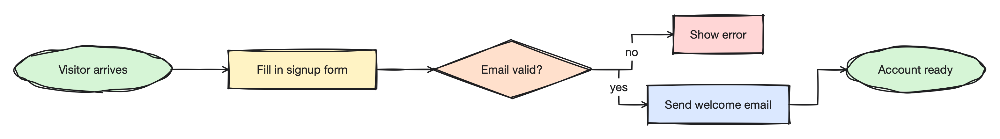

# Dottie

**Diagrams that look hand-drawn, on your Mac, and your AI assistant can draw them for you.**

Sketch a flowchart, a system diagram or a whiteboard idea in seconds. Switch to a clean, precise look when it
needs to go in a document. Or just ask Claude to draw it, and watch the shapes appear.

## Get Dottie

1. Download the latest `Dottie-x.y.z.zip` from [Releases](https://github.com/phin-tech/dottie/releases).
2. Unzip it and drag **Dottie** into your Applications folder.
3. Open it. You need macOS 14 Sonoma or later.

## Ask your AI assistant to draw

Dottie works with Claude and other assistants that support MCP (a standard way for assistants to use apps).
Once connected, you can say things like:

- *"Draw our deployment pipeline as a left-to-right diagram."*
- *"Add a staging step between build and deploy."*
- *"Make a second page with the database tables, and link the Database box to it."*
- *"Make it clean instead of sketchy and save it as an SVG."*

The assistant lays the diagram out, looks at the result, and tidies anything that reads badly.

### Connect it once

Open Dottie, then **Dottie ▸ Settings… ▸ MCP**. Under *Add to an MCP client*:

- **Claude Desktop** (and most other apps): click **Copy** next to the JSON snippet, paste it into the
  app's MCP settings file, and restart the app. In Claude Desktop that file is under
  Settings ▸ Developer ▸ Edit Config.
- **Claude Code:** click **Copy** next to the command, and run it once in Terminal.

If you move Dottie to a different folder later, copy the snippet again.

### Watch it draw

Keep the drawing open in Dottie while you chat, and every change appears in the window as the assistant makes
it. Each change can be undone with ⌘Z, like your own. Save when you like the result. You can tell the assistant
to work on "the drawing I have open", or give it a file path. If Dottie isn't running, the assistant edits the
file directly and you see the result next time you open it.

## Draw it yourself

Pick a tool from the toolbar or press its letter:

| Key | Tool | | Key | Tool |
|---|---|---|---|---|
| V | Select | | T | Text |
| R | Rectangle | | C | Connector |
| O | Ellipse | | P | Pencil |
| D | Diamond | | E | Eraser |
| N | Note | | | |

Double-click a shape to give it a label. Connectors stay attached when you move shapes around.

- **Sticky notes.** Click with the Note tool (or drag out a size) and type GitHub Flavored Markdown:
  headings, bullet, numbered and `- [ ]` task lists, tables, quotes, code, links, and **bold**, *italic*,
  `code` and ~~struck~~ text. A new line in the text is a new line in the note, as in GitHub comments. Return
  starts a new line; ⇧Return, ⌘Return, Escape or clicking away finishes, and the note shows the rendered text.

- **Sketchy or clean.** The inspector on the right switches the look, and sets colors, fill patterns,
  dashed lines and arrowheads. Themes like Blueprint and Chalkboard change the whole page.
- **Pages.** Big diagram? Split it into pages, shown as tabs along the bottom. Click **+** to add one,
  double-click a tab to rename it, drag tabs to reorder them.
- **Links.** Make a shape jump to another one, even on another page: select it and choose a target under
  **Jumps to**. Click the little arrow badge to go there, and ⌘[ to come back. Great for a summary page that
  links to the details.
- **Shape library.** The Library tab has flowchart symbols and common shapes ready to drag in. Add your own
  from SVG files or from shapes you've drawn.
- **Layers, rulers and guides** for when things need to line up exactly (⇧⌘R shows the rulers).
- **Bring diagrams in** from Excalidraw, draw.io or SVG files (File menu, or drop them on the canvas).
- **Send diagrams out** as PNG, SVG or PDF with File ▸ Export As.

## Extras for power users

- **Scripting.** Script ▸ Script Console… (⌥⌘J) runs JavaScript to draw or change many things at once, such as
  a grid of boxes or restyling everything labelled "TODO". The console includes a full reference.
- **Command line.** Settings ▸ Command Line installs a `dottie` command, so you can turn drawings into images
  from Terminal: `dottie render diagram.dottie -o diagram.png`. Run `dottie --help` for more.

## Help and feedback

Found a bug or have an idea? [Open an issue](https://github.com/phin-tech/dottie/issues). Want to build Dottie
yourself or contribute? See [DEVELOPMENT.md](DEVELOPMENT.md).

## License

Dottie is free and open source under the [Apache License 2.0](LICENSE).
